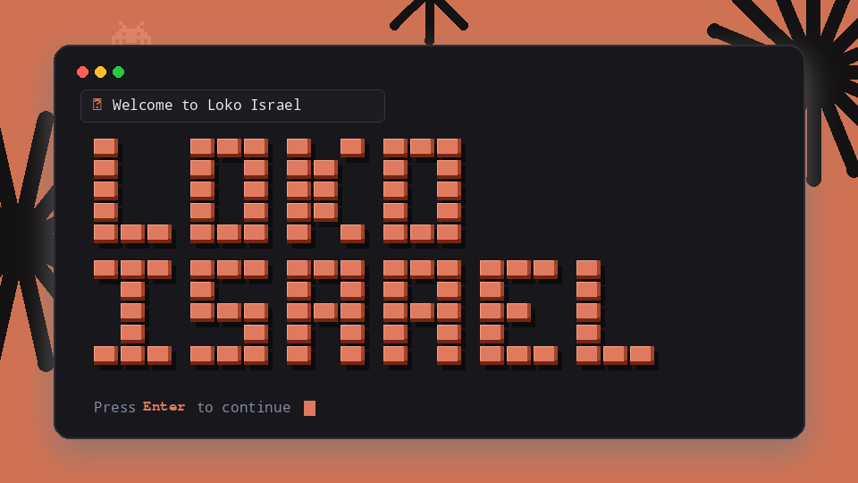

<p align="center">
  
</p>

<div align="center">
  <p>
    <code>Software Engineering</code> • <code>Cross-Platform Mobile Apps</code> • <code>System Architecture &amp; Infra</code> • <code>DSA</code>
  </p>
  <p>
    <a href="https://github.com/fluxaro">
      
    </a>
  </p>
</div>

<p align="center">
  
</p>

<p align="center">  
  <!-- Profile Views Counter -->
      
  
  <!-- GitHub Followers Badge -->
  
  
  <!-- GitHub Stars Badge -->
      
  
  <!-- Public Repositories Counter -->
  
</p>

<p align="center">
  
</p>

## 🛸 About Me

<div align="left">

<p>
  I'm a <strong>Software Engineer &amp; Systems Architect</strong> building high-performance systems across the stack. 
  My work spans <strong>cross-platform mobile app development</strong>, <strong>distributed backend infrastructure</strong>, and <strong>system design</strong> powered by rigorous <strong>Data Structures &amp; Algorithms (DSA)</strong>.
</p>

<p>
  With <strong>Go</strong> and <strong>TypeScript</strong> at my backend core, I architect resilient, concurrent services and scalable infrastructure engineered to endure real production workloads.
</p>

```yaml
system_spec:
  handle: "@fluxaro"
  engineer: "Loko Israel Tomisin"
  roles: 
    - "Software Engineer"
    - "Cross-Platform Mobile App Developer"
    - "System Architect & Infra Builder"
  core_stack:
    backend: ["Go (Golang)", "Node.js / Express", "PostgreSQL", "Supabase", "Redis"]
    mobile: ["React Native", "Expo", "Cross-Platform Architecture"]
    systems: ["Distributed Infrastructure", "Docker", "System Design & Scalability"]
    foundations: ["Data Structures & Algorithms (DSA)", "Concurrency Models", "API Contracts"]
  design_paradigm: "Domain-Driven • Algorithmic Rigor • Fault-Tolerant • High-Throughput"
  rule_0: "First master the algorithm and architecture. Then write clean, idiomatic code."
```

</div>

<p align="center">
  
</p>

## 🛠️ Tech Stack & Arsenal

<div align="left">

### ⚡ Core Languages & Foundations
<p>
  
  
  
  
  
  
</p>

### 📱 Mobile App & Cross-Platform Engineering
<p>
  
  
  
  
  
</p>

### 🏗️ Backend, Infrastructure & System Architecture
<p>
  
  
  
  
  
  
  
  
</p>

### 🤖 AI Engineering & Autonomous Systems
<p>
  
  
  
  
  
</p>

### ⚛️ Web & Interfaces
<p>
  
  
  
  
</p>

### 🧰 Cloud, DevOps & Tooling
<p>
  
  
  
  
  
  
</p>

</div>

<p align="center">
  
</p>

<details open>
  <summary><h2>📊 Telemetry &amp; GitHub Stats</h2></summary>

  <br>
  
<p align="center">

  <!-- Row 1: Main Stats + Alternate Stats -->
  <a href="https://github.com/fluxaro" target="_blank" style="margin-right:16px;">
    
  </a>

  <a href="https://github.com/fluxaro" target="_blank">
    
  </a>

</p>

<p align="center" style="margin-top:16px;">

  <!-- Row 2: Streak Stats + Top Languages -->
  <a href="https://github.com/fluxaro" target="_blank" style="margin-right:16px;">
      
  </a>

  <a href="https://github.com/fluxaro" target="_blank">
    
  </a>

</p>

</details>

<h2>📈 Contribution Activity Graph</h2>

<div align="center">
  <a href="https://github.com/fluxaro">
    
  </a>
</div>

<h2>🟡 Pacman Contribution Feed</h2>

<div align="center">
  <picture>
    <source media="(prefers-color-scheme: dark)" srcset="https://raw.githubusercontent.com/fluxaro/fluxaro/output/pacman-contribution-graph-dark.svg" />
    <source media="(prefers-color-scheme: light)" srcset="https://raw.githubusercontent.com/fluxaro/fluxaro/output/pacman-contribution-graph.svg" />
    
  </picture>
  <br/>
  <sub><i>Auto-generated every 12 hours via GitHub Actions.</i></sub>
</div>

<br>

<p align="center">
  
</p>

<h2 align="left">🧠 Operating Principles &amp; Quotes</h2>

<div align="center">

<table>
<tr>
<td align="center">

$\color{#E07A5F}\Large{\text{❝}}$  $\color{#38BDAE}\large{\text{Good architecture is the difference between a system that scales and one that survives.}}$  $\color{#E07A5F}\Large{\text{❞}}$  
<div align="right">$\color{#70A5FD}\normalsize{\text{— System Axiom}}$</div>

</td>
</tr>
<tr>
<td align="center">
  
$\color{#E07A5F}\Large{\text{❝}}$  $\color{#38BDAE}\large{\text{First, solve the problem. Then, write the code.}}$  $\color{#E07A5F}\Large{\text{❞}}$  
<div align="right">$\color{#70A5FD}\normalsize{\text{— John Johnson}}$</div>

</td>
</tr>
</table>

</div>

<p align="center">
  
</p>

## 🔗 Connect &amp; Establish Uplink

<p align="center">
  <a href="mailto:israelloko65@gmail.com"></a>
  <a href="https://www.linkedin.com/in/loko-israel-tomisin"></a>
  <a href="https://x.com/israelloko65"></a>
  <a href="https://github.com/fluxaro"></a>
  <a href="https://israelloko.vercel.app/"></a>
  <a href="https://www.instagram.com/cyber_xoder/"></a>
  <a href="https://www.tiktok.com/@technocrat911"></a>
</p>

<p align="center">
  
</p>

<br>

<h6 align="center">⚡ Engineered by <strong>Loko Israel Tomisin</strong> (<code>@fluxaro</code>) • Architected for scale and survival.</h6>
